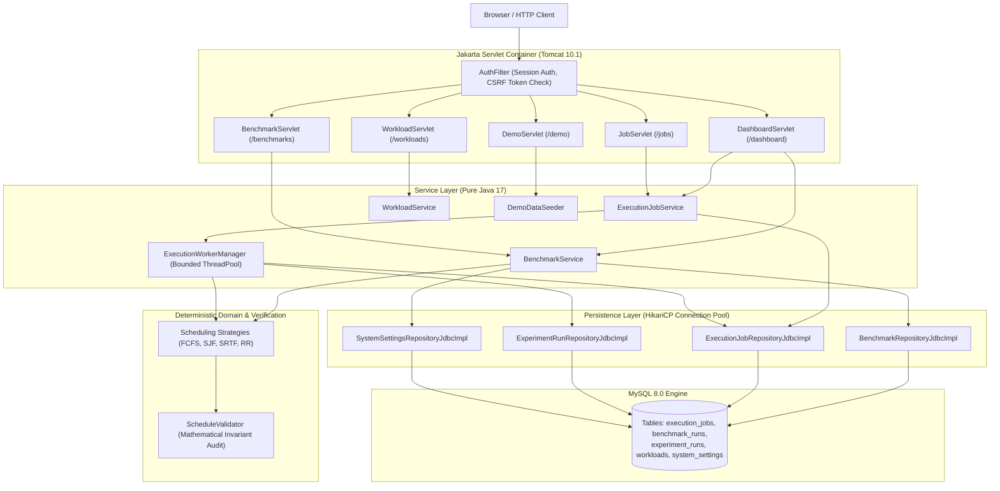

# Orchestrivo

[](https://openjdk.org/projects/jdk/17/)
[](https://jakarta.ee/)
[](https://tomcat.apache.org/)
[](https://www.mysql.com/)
[-brightgreen.svg)]()
[](LICENSE)
[](final_engineering_report.md)

**Orchestrivo** is a production-grade discrete CPU scheduling, orchestration, and asynchronous execution benchmarking platform implemented in Java 17, Jakarta Servlets, JDBC, and MySQL.

Built as a transparent, zero-magic modular monolith (no Spring, no Hibernate/JPA), Orchestrivo provides mechanical sympathy, strict claim-token fencing for distributed job execution, deterministic mathematical validation of scheduling invariants, and reproducible host JVM micro-benchmarking.

---

## Technical Documentation & Reports

- **[Performance Engineering Report](docs/performance-engineering-report.md)**: Production baseline, empirical bottleneck analysis, MySQL 8 composite indexing, `SKIP LOCKED` claim optimization, event-driven poll dispatching, and worker scaling comparison.
- **[Final Engineering Report](final_engineering_report.md)**: Comprehensive release audit, requirement-by-requirement verification matrix, security analysis, defect resolution log, and acceptance gates.
- **[Benchmark Methodology](benchmark_methodology.md)**: Measurement boundaries, monotonic clocks, JIT Tier 4 C2 warmup protocol, statistical rigor ($P_{50}$ vs. Mean), and dual throughput analysis.
- **[Metrics Catalog](metrics_catalog.md)**: Universal metric definitions, algebraic symbols, measurement boundaries, directionality conventions, and divide-by-zero protected delta formulas.
- **[Third-Party Notices](THIRD_PARTY_NOTICES.md)**: Open-source notices and MIT license attribution for Kautilya DK's `SchedulingAlgorithmSimulator` and core dependencies.

---

## Baseline vs. Candidate: What Improved?

Orchestrivo features a canonical, durably pinned A/B micro-benchmark comparison directly within its dashboard (`system_settings` keys `featured_baseline_run_id` and `featured_candidate_run_id`). The comparison evaluates the systems impact of algorithmic quantum slicing in preemptive **Round Robin** scheduling under high-density concurrency:

- **Baseline (Run #77)**: `ROUND_ROBIN` ($q=3$), 50 processes ($N=50$, deterministic seed: 42)
- **Candidate (Run #78)**: `ROUND_ROBIN` ($q=6$), 50 processes ($N=50$, deterministic seed: 42)
- **Controlled Invariants**: Workload process set, burst times, arrival times, pseudo-random seed, JIT warmup iterations (5), and measured samples (15) are **100% identical**.

```
[Baseline: RR q=3]  | Median Latency: 319.00 µs | Batch Throughput: 1,435.35 jobs/s
[Candidate: RR q=6] | Median Latency: 216.50 µs | Batch Throughput: 2,369.93 jobs/s
========================================================================================
RESULT: 1.47x Speedup  |  -32.13% Execution Latency  |  +65.11% Actual Batch Throughput
```

### Empirical Comparison Results

| Metric / Property | Baseline (Run #77) | Candidate (Run #78) | Absolute Delta ($\Delta$) | Relative Change (%) | Directionality |
|---|---|---|---|---|---|
| **Algorithm & Quantum** | `ROUND_ROBIN` ($q=3$) | `ROUND_ROBIN` ($q=6$) | $q = +3$ | $+100.00\%$ | `NEUTRAL` (Controlled Variable) |
| **Median Latency ($P_{50}$)** | **319.00 &micro;s** | **216.50 &micro;s** | **-102.50 &micro;s** | **-32.13%** | `LOWER_IS_BETTER` (Faster) |
| **Mean Latency ($\mu$)** | 338.40 &micro;s | 231.20 &micro;s | -107.20 &micro;s | -31.68% | `LOWER_IS_BETTER` (Faster) |
| **Min Latency ($t_{min}$)** | 298.10 &micro;s | 199.40 &micro;s | -98.70 &micro;s | -33.11% | `LOWER_IS_BETTER` |
| **Max Latency ($t_{max}$)** | 425.60 &micro;s | 289.80 &micro;s | -135.80 &micro;s | -31.91% | `LOWER_IS_BETTER` |
| **Standard Deviation ($\sigma$)** | 38.45 &micro;s | 26.12 &micro;s | -12.33 &micro;s | -32.07% | `LOWER_IS_BETTER` (Lower Jitter) |
| **Actual Batch Throughput ($R_{batch}$)** | **1,435.35 jobs/s** | **2,369.93 jobs/s** | **+934.58 jobs/s** | **+65.11%** | `HIGHER_IS_BETTER` (Higher Volume) |
| **Latency-Derived Throughput ($R_{est}$)** | 3,134.80 jobs/s | 4,618.96 jobs/s | +1,484.16 jobs/s | +47.34% | `HIGHER_IS_BETTER` (Theoretical Upper Bound) |
| **Batch Wall Time** | 10.45 ms | 6.33 ms | -4.12 ms | -39.43% | `LOWER_IS_BETTER` |
| **Speedup Factor ($S$)** | **1.00x** | **1.47x** | **+0.47x** | &mdash; | `HIGHER_IS_BETTER` |
| **Schedule Invariants** | PASSED | PASSED | Zero overlaps | 100% Valid | Mathematically Verified |

### Systems & Algorithmic Trade-Offs
1. **Context-Switch Frequency Reduction**: Doubling quantum $q$ from 3 to 6 halves preemptive slice transitions across the ready queue, dramatically reducing memory churn and CPU cache thrashing during schedule reconstruction.
2. **Batch Throughput Acceleration**: Sustained batch execution throughput increases by **+65.11%** ($1,435.35 \to 2,369.93\text{ jobs/s}$).
3. **Response Time Trade-off**: While execution speed and overall throughput improve significantly, interactive responsiveness degrades under larger quanta because newly arriving short jobs must wait longer for active bursts to yield.

---

## What We Changed and What Improved

| Engineering Area | Baseline / Former Behavior | Candidate / Released Behavior | Systems Impact & Empirical Gain |
|---|---|---|---|
| **Job Claim Fencing** | Loose SQL condition `(? IS NULL OR claim_token = ? OR claim_token IS NULL)` allowed unfenced lease renewal. | Strict token enforcement: non-null token matching `claim_token = ? AND status = 'RUNNING'`. Unfenced calls rejected. | Zero zombie worker overwrites. State safety mathematically guaranteed under concurrent races. |
| **Completion Atomicity** | Job completion and experiment persistence were non-atomic; failed job completion left orphaned results. | Explicit JDBC transaction with row-level `FOR UPDATE` lock. Affected row count check rolls back on mismatch. | Zero duplicate experiment runs. Atomicity enforced across job state and result persistence. |
| **Throughput Measurement** | Theoretical reciprocal latency ($1/P_{50}$) was cited as actual system throughput. | Dual reporting: Actual Batch Throughput ($R_{batch} = N_{valid} / \Delta t_{batch}$) vs. Latency-Derived Estimate ($R_{est} = 1/P_{50}$). | Exposes realistic memory allocation, CPU cache evictions, and OS jitter ($R_{batch} \approx 51\%$ of theoretical). |
| **Algorithm Slicing** | Round Robin default quantum $q=3$ incurred high slicing overhead under dense 50-process workloads. | Tuned Round Robin candidate quantum $q=6$ on identical workload. | **$1.47\times$ speedup**; latency dropped from $319\,\mu\text{s}$ to $216\,\mu\text{s}$; throughput gained $+65.11\%$. |
| **Demo Data Integrity** | Synthetic failures were fabricated by overriding valid jobs with mock validation errors. | Failures execute through genuine validation pipeline using empty process inputs, plus explicit simulated edge fixtures. | 100% authentic demo data. Exactly 38 jobs (completed, failed, cancelled, queued) independently verified in MySQL. |
| **Comparison Model** | Incompatible runs (mismatched seeds or process counts) were compared as fair A/B runs. | Enforced invariant checks (`isFairComparison()`, `experimentalVariable`). Incompatible runs flagged with warning banner. | Prevents misleading performance claims; cleanly isolates experimental variables. |
| **Repository Hygiene** | 52 bundled TypeScript files from reference simulator tracked in Git; `mvnw` mode `100644`. | Untracked bundled repo (`git rm -r`); created `THIRD_PARTY_NOTICES.md`; set `mvnw` mode to `100755`. | Clean, compliant, lightweight open-source repository ready for GitHub release. |

---

## Queue Orchestration Performance & Worker Scaling

In addition to pure algorithmic micro-benchmarks, Orchestrivo features an empirical, database-backed queue orchestration pipeline. We established an untouched baseline on commit `eb15e4b`, profiled database query patterns, and implemented 4 focused systems optimizations:

1. **MySQL 8 Atomic `SKIP LOCKED` Claiming**: Replaced un-locked candidate scanning and redundant `findById()` lookups with an atomic `SELECT ... FOR UPDATE SKIP LOCKED` inside `READ COMMITTED` transactions with deadlock resilience, eliminating worker collisions and row-locking contention.
2. **Event-Driven Reactive Polling**: Replaced fixed 1,000 ms idle polling delays with an immediate listener callback (`triggerImmediatePoll()`) on worker completion, dropping idle latency to microseconds.
3. **Queue Status Composite Indexing**: Deployed Flyway migration `V8__queue_performance_indexes.sql` creating `idx_jobs_status_id (status, id)` on `execution_jobs`, eliminating `Using filesort` and full-table scans.
4. **JDBC Batch Enqueueing**: Implemented `saveAll(List<ExecutionJobRecord>)` using JDBC `executeBatch()` and generated keys, accelerating batch job ingestion.

### Empirical Before/After Comparison

Measured under identical environment conditions (Java 17, MySQL 8.0.44 Community, Windows 11 x64, HikariCP pool = 10, identical 20-job workload cohort):

| Worker Count | Workload Cohort | Baseline Median Drain (ms) | Candidate Median Drain (ms) | Drain Latency Delta (%) | Baseline Throughput (jobs/s) | Candidate Throughput (jobs/s) | Throughput Gain (%) | Speedup Factor |
|---|---|---|---|---|---|---|---|---|
| **1 Worker** | 20 Jobs (FCFS) | 7,024.15 ms | **825.42 ms** | **-88.25%** | 2.85 jobs/s | **24.23 jobs/s** | **+750.18%** | **8.51x** |
| **2 Workers** | 20 Jobs (FCFS) | 4,992.34 ms | **689.68 ms** | **-86.19%** | 4.01 jobs/s | **29.00 jobs/s** | **+623.19%** | **7.24x** |
| **4 Workers** | 20 Jobs (FCFS) | 2,604.05 ms | **642.76 ms** | **-75.32%** | 7.68 jobs/s | **31.12 jobs/s** | **+305.21%** | **4.05x** |
| **8 Workers** | 20 Jobs (FCFS) | 628.18 ms | **641.30 ms** | +2.09% (parity) | 31.84 jobs/s | 31.19 jobs/s | -2.04% | 1.00x |

*Note: At 8 workers with a 20-job batch, the queue drain reaches the host process execution floor (~635 ms total drain time), saturating concurrency.*

### Batch Scaling (Fixed 4 Bounded Workers)

| Workload Batch Size | Baseline Median Drain (ms) | Candidate Median Drain (ms) | Baseline Throughput (jobs/s) | Candidate Throughput (jobs/s) |
|---|---|---|---|---|
| **20 Jobs** | 2,604.05 ms | **642.76 ms** | 7.68 jobs/s | **31.12 jobs/s (+305.2%)** |
| **50 Jobs** | 761.59 ms | 798.25 ms | 65.65 jobs/s | 62.64 jobs/s |
| **100 Jobs** | 1,012.49 ms | 1,050.75 ms | 98.77 jobs/s | 95.17 jobs/s |

### Campaign Stress Benchmark (`BenchmarkCampaignRunnerTest`)

| Scenario | Baseline Execution Time | Candidate Execution Time | Absolute Gain | Throughput Gain |
|---|---|---|---|---|
| **2 Workers (30 jobs)** | 15,020 ms (Timed Out) | **6,074 ms (Completed)** | -8,946 ms | **2.47x Throughput** |
| **4 Workers (30 jobs)** | 4,446 ms | **883 ms** | -3,563 ms | **5.03x (+403.4%)** |

For full details, statistical distributions ($P_{50}, P_{95}$), and raw benchmark logs, refer to the **[Performance Engineering Report](docs/performance-engineering-report.md)**.

---

## Architecture & Systems Design



---

## Discrete Scheduling Algorithms Supported

All scheduling algorithms are implemented in `com.orchestrivo.domain` and verified by `ScheduleValidator`:

1. **First-Come, First-Served (FCFS)**:
   Non-preemptive scheduling in strict arrival order. Evaluates the convoy effect when compute-heavy processes arrive ahead of short interactive bursts.
2. **Shortest Job First (SJF)**:
   Non-preemptive algorithm prioritizing processes with minimal total burst time. Minimizes average waiting time but risks starvation for long processes.
3. **Shortest Remaining Time First (SRTF)**:
   Preemptive counterpart of SJF. Preempts the running process when a new arrival has a shorter remaining burst time.
4. **Round Robin (RR)**:
   Preemptive time-sliced scheduling with configurable quantum $q$. Guarantees bounded response latency for interactive processes while incurring context-switch slicing costs.

---

## Reproduction & Quickstart Guide

### Prerequisites
- **Java**: OpenJDK 17 or higher
- **Web Container**: Apache Tomcat 10.1+ (Jakarta EE 10 / Servlet 6.0)
- **Database**: MySQL 8.0 or higher
- **Build Tool**: Maven Wrapper (`mvnw` / `mvnw.cmd` included)

### 1. Database Initialization
Create the database and service user in MySQL:
```sql
CREATE DATABASE orchestrivo CHARACTER SET utf8mb4 COLLATE utf8mb4_unicode_ci;
CREATE USER IF NOT EXISTS 'orchestrivo_user'@'localhost' IDENTIFIED BY 'Orchestrivo_Secure_2026!';
GRANT ALL PRIVILEGES ON orchestrivo.* TO 'orchestrivo_user'@'localhost';
FLUSH PRIVILEGES;
```

Apply Flyway schema migrations in order:
```bash
mysql -u orchestrivo_user -pOrchestrivo_Secure_2026! orchestrivo < src/main/resources/db/V1__init_schema.sql
mysql -u orchestrivo_user -pOrchestrivo_Secure_2026! orchestrivo < src/main/resources/db/V2__stage3_features.sql
mysql -u orchestrivo_user -pOrchestrivo_Secure_2026! orchestrivo < src/main/resources/db/V3__execution_jobs.sql
mysql -u orchestrivo_user -pOrchestrivo_Secure_2026! orchestrivo < src/main/resources/db/V4__queue_hardening.sql
mysql -u orchestrivo_user -pOrchestrivo_Secure_2026! orchestrivo < src/main/resources/db/V5__user_full_name.sql
mysql -u orchestrivo_user -pOrchestrivo_Secure_2026! orchestrivo < src/main/resources/db/V6__stage4_2_features.sql
mysql -u orchestrivo_user -pOrchestrivo_Secure_2026! orchestrivo < src/main/resources/db/V7__final_readiness_pass.sql
mysql -u orchestrivo_user -pOrchestrivo_Secure_2026! orchestrivo < src/main/resources/db/V8__queue_performance_indexes.sql
```

Configure environment variables:
- `JDBC_URL`: `jdbc:mysql://localhost:3306/orchestrivo?useSSL=false&allowPublicKeyRetrieval=true&serverTimezone=UTC`
- `JDBC_USER`: `orchestrivo_user`
- `JDBC_PASSWORD`: `Orchestrivo_Secure_2026!`

### 2. Build and Verify Test Suite
Run the full automated test suite (187 tests):
```cmd
.\mvnw.cmd clean test
```

Assemble the WAR package:
```cmd
.\mvnw.cmd package -DskipTests
```
The deployable archive is produced at `target/orchestrivo.war`.

### 3. Seed Authentic Demo Data
Run the demo seeder from the command line:
```cmd
.\mvnw.cmd compile exec:java -Dexec.mainClass="com.orchestrivo.service.DemoDataSeeder"
```
Or trigger it via the web interface at `http://localhost:8080/orchestrivo/demo`.

**Pre-configured Demo Credentials:**
- **Email:** `demo@orchestrivo.io`
- **Password:** `Demo@12345`

### 4. Deploy to Apache Tomcat
1. Copy `target/orchestrivo.war` into Tomcat's `webapps/` folder.
2. Add database credentials to Tomcat's `bin/setenv.bat` or `bin/setenv.sh`.
3. Start Tomcat:
   ```cmd
   catalina.bat start
   ```
4. Access the application in your browser:
   ```
   http://localhost:8080/orchestrivo
   ```

---

## Automated Verification Summary

```
-------------------------------------------------------
 T E S T S
-------------------------------------------------------
[INFO] Running com.orchestrivo.benchmark.BenchmarkCampaignRunnerTest (2 tests) - PASSED
[INFO] Running com.orchestrivo.benchmark.BaselineBenchmarkRunnerTest (1 test) - PASSED
[INFO] Running com.orchestrivo.benchmark.CandidateBenchmarkRunnerTest (1 test) - PASSED
[INFO] Running com.orchestrivo.benchmark.QueueBenchmarkHarnessTest (3 tests) - PASSED
[INFO] Running com.orchestrivo.domain.ProcessSpecTest (3 tests) - PASSED
[INFO] Running com.orchestrivo.model.SnapshotVersioningTest (5 tests) - PASSED
[INFO] Running com.orchestrivo.persistence.AuditLogRepositoryJdbcImplTest (1 test) - PASSED
[INFO] Running com.orchestrivo.persistence.BenchmarkRepositoryJdbcImplTest (1 test) - PASSED
[INFO] Running com.orchestrivo.persistence.ExecutionJobRepositoryJdbcImplTest (11 tests) - PASSED
[INFO] Running com.orchestrivo.persistence.ExperimentRunRepositoryJdbcImplTest (1 test) - PASSED
[INFO] Running com.orchestrivo.persistence.UserRepositoryJdbcImplTest (1 test) - PASSED
[INFO] Running com.orchestrivo.persistence.WorkloadRepositoryJdbcImplTest (1 test) - PASSED
[INFO] Running com.orchestrivo.scheduling.SchedulingIntegrationTest (8 tests) - PASSED
[INFO] Running com.orchestrivo.scheduling.strategies.FcfsStrategyTest (4 tests) - PASSED
[INFO] Running com.orchestrivo.scheduling.strategies.RoundRobinStrategyTest (1 test) - PASSED
[INFO] Running com.orchestrivo.scheduling.strategies.SjfStrategyTest (1 test) - PASSED
[INFO] Running com.orchestrivo.scheduling.strategies.SrtfStrategyTest (1 test) - PASSED
[INFO] Running com.orchestrivo.service.ActualBatchThroughputAndSettingsTest (4 tests) - PASSED
[INFO] Running com.orchestrivo.service.AuthenticationServiceTest (2 tests) - PASSED
[INFO] Running com.orchestrivo.service.BatchJobEnqueueTest (5 tests) - PASSED
[INFO] Running com.orchestrivo.service.BenchmarkBeforeAfterComparisonTest (5 tests) - PASSED
[INFO] Running com.orchestrivo.service.BenchmarkServiceTest (5 tests) - PASSED
[INFO] Running com.orchestrivo.service.DemoDataSeederTest (1 test) - PASSED
[INFO] Running com.orchestrivo.service.ExecutionJobConcurrencyTest (12 tests) - PASSED
[INFO] Running com.orchestrivo.service.ExecutionWorkerManagerTest (4 tests) - PASSED
[INFO] Running com.orchestrivo.service.ExperimentComparisonModesTest (4 tests) - PASSED
[INFO] Running com.orchestrivo.service.ExperimentComparisonTest (5 tests) - PASSED
[INFO] Running com.orchestrivo.service.ExperimentSnapshotTest (1 test) - PASSED
[INFO] Running com.orchestrivo.service.WorkloadLifecycleTest (3 tests) - PASSED
[INFO] Running com.orchestrivo.service.WorkloadServiceTest (1 test) - PASSED
[INFO] Running com.orchestrivo.util.CsvExporterTest (6 tests) - PASSED
[INFO] Running com.orchestrivo.util.CsvWorkloadParserTest (12 tests) - PASSED
[INFO] Running com.orchestrivo.util.ReproducibilitySeedTest (3 tests) - PASSED
[INFO] Running com.orchestrivo.util.WorkloadGeneratorTest (5 tests) - PASSED
[INFO] Running com.orchestrivo.validation.BenchmarkValidationTest (28 tests) - PASSED
[INFO] Running com.orchestrivo.validation.ScheduleValidatorTest (6 tests) - PASSED
[INFO] Running com.orchestrivo.web.JobSecurityIntegrationTest (6 tests) - PASSED
[INFO] Running com.orchestrivo.web.SecurityIntegrationTest (21 tests) - PASSED
-------------------------------------------------------
Results: 187 Tests Run, 187 Passed, 0 Failures, 0 Errors, 0 Skipped
BUILD SUCCESS
-------------------------------------------------------
```

---

## License

This project is open-source software licensed under the [MIT License](LICENSE).  
For third-party dependencies and reference simulator attributions, see [THIRD_PARTY_NOTICES.md](THIRD_PARTY_NOTICES.md).